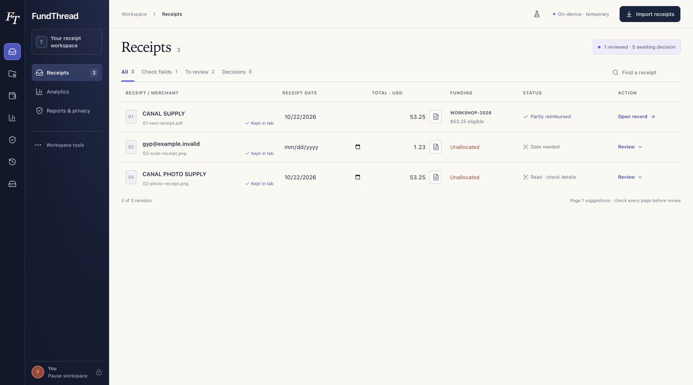
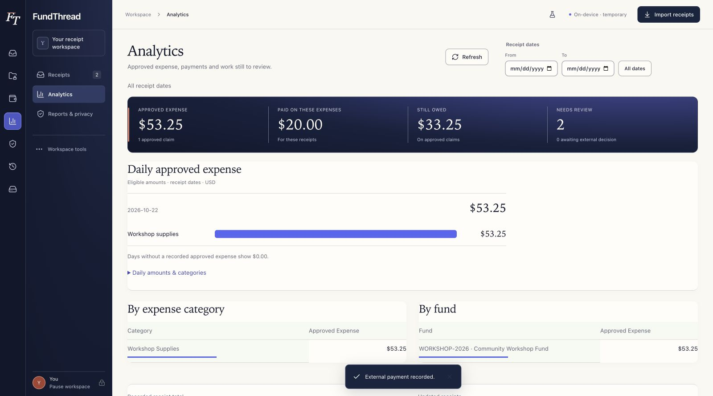
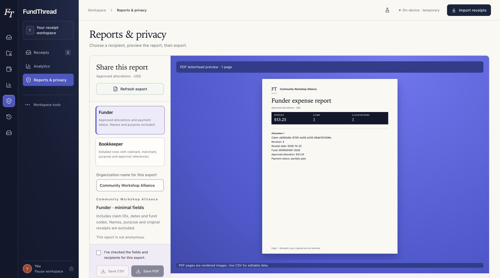

# FundThread

**Keep the receipt. Follow the funds.**

FundThread helps nonprofit staff follow an expense from its original receipt to a reviewed claim, grant allocation, external approval, payment record, and report they can share deliberately.

The main views are **Receipts**, **Analytics**, and **Reports & privacy**. Grant funds, reimbursements, activity, and recovery support that core workflow.

**[Try the browser demo](https://fundthread.tarpit-ai.chatgpt.site)** · **[Watch the video](https://youtu.be/EU2lbzVB3sE)**

The hosted demo is publicly viewable and requires no installation. Explore the fictional sample or import receipts into a temporary workspace. Records and uploads stay in the browser tab's memory and clear on reload; download any outputs you need before leaving.



## Run locally

Requires **Node.js 22.12+ and npm**. No database, Rust installation, account, or API key is needed for browser mode.

From a terminal on your own computer:

```sh
git clone https://github.com/igoreydman/fundthread.git
cd fundthread
npm ci
npm run build:browser
npm run preview:browser
```

Keep the terminal running. Once Vite reports that the preview server is ready, open `http://127.0.0.1:1421/` in a browser on the same computer. This address points to your own computer and only works while the local server is running. To start it again later, run `npm run preview:browser` from the `fundthread` folder. If port 1421 is occupied, stop the other server or use `npm run preview:browser -- --port 1422` and open the address Vite prints.

Explore the fictional Tidepath records, or choose **Import receipts** to start a separate workspace with your own files. Try the fictional [receipt PDF](docs/examples/receipt-to-import.synthetic.pdf) or [receipt photo](docs/examples/receipt-photo.synthetic.png).

**Browser storage is temporary:** originals and records stay in this tab's memory. Reloading, closing, or returning to the sample clears that workspace. Download needed reports and reviewed receipt copies first. This is not a persistent archive or backup.

For frontend development with hot reload:

```sh
npm run dev
```

Open **http://127.0.0.1:1420/**. Asset preparation runs automatically. English OCR data, workers, WebAssembly, PDF support, and fonts are bundled locally. Document processing does not call an external processing service or download a model at runtime. Fresh offline launch is not supported as an installed PWA.

See [browser hosting, security headers, and file limits](docs/browser-demo.md). Serve the production build over HTTP/HTTPS; do not open the HTML as a file.

## How it works

1. **Check the funds.** Record an opening budget, dates, allowed categories, and source notes. Available recorded budget reflects approved allocations; it is not a bank balance.
2. **Add receipts.** Batch-import PDF, JPEG, or PNG files. Successful files survive individual failures; exact duplicates are flagged. Supported documents are read locally one at a time. Original bytes and SHA-256 identities are preserved.
3. **Check the evidence.** PDF text or English OCR suggests merchant, date, and total. Open the original beside its details, then return to the same amount field. Correct suggestions and add recipient, purpose, category, eligible amount, and funding. Drafts save automatically; review remains explicit.
4. **Review and record the decision.** Mark a complete expense reviewed, then attribute an approval made outside FundThread. Allocations use exact integer-cent amounts and can be split across funds. Configured dates, categories, and budgets are checked at approval. Changing reviewed values invalidates the old approval.
5. **Track payment separately.** Record a payment already made elsewhere with its date and reference. Partial payments reduce what is owed without consuming the grant budget twice. Bank reconciliation is a separate action. FundThread does not transfer money.
6. **Understand spend.** Analytics shows daily approved eligible expense, categories, funds, payments, balances owed, and work awaiting review. Filters use receipt dates. Undated receipts are disclosed separately rather than assigned an invented day. Multi-day category charts and daily detail tables support inspection.
7. **Choose what to share.** Preview a minimal funder report or detailed bookkeeper report, check fields and recipients, then save CSV or PDF. CSV columns labeled `_usd` contain exact decimal dollars. PDFs carry the organization's name as letterhead. Analytics also exports its selected aggregate view.



## Complete example

The submission walkthrough starts with one **$200.00** fund and two unreviewed receipts. A third receipt is uploaded and read locally. Staff verify its **$53.25** total, complete its context and allocation, explicitly review it, and record an external approval.

The fund shows **$53.25 approved** and **$146.75 remaining**. Recording an external **$20.00** payment leaves **$33.25 owed**, while fund usage stays **$53.25**. Analytics and the letterhead report show that same approved expense. The other receipts remain unreviewed rather than entering reports automatically.

Watch the [demo video](https://youtu.be/EU2lbzVB3sE). The [walkthrough script](docs/submission/video-script.txt) and [submission description](docs/submission/description.txt) provide additional context. All demonstration people, organizations, receipts, and references are fictional.

## Privacy and exports

The funder report excludes claimant names, merchants, purpose, and approval identities. It still includes claim IDs, dates, amounts, and fund codes, so it is **not anonymous**. The bookkeeper profile includes detailed fields. Formula-leading CSV text cells are escaped, and exports check that reviewed data has not changed.

For receipt sharing, staff save mask regions, inspect possible contact/name matches, manually mask other details, review every page, and export a fresh image-only PDF. Original bytes remain unchanged. Suggestions can miss private information; a person must check the copy before sharing.

**Report PDFs are rendered page images, not searchable/selectable text or tagged accessible documents.** CSV provides editable data. Reports and masked copies are outputs, not workspace backups.



## Run the persistent desktop app

Desktop mode additionally requires **Tauri 2 platform prerequisites, Rust 1.99.1** (pinned in `rust-toolchain.toml`), and **PostgreSQL 16+**.

1. Create a dedicated database and application role using [PostgreSQL operations](docs/postgres-operations.md).
2. Inject **FUNDTHREAD_DATABASE_URL** into the native process environment through your launch environment or secret manager. `.env.example` documents its shape; `.env` is not loaded automatically. Never use a `VITE_` variable for credentials.
3. Run:

```sh
npm ci
npm run desktop
```

An empty database asks for organization/operator details. Native dialogs import/save actual files. Originals, OCR artifacts, versioned reviews, allocations, approvals, payments, masks, and history live in PostgreSQL. Normalized relations and transactions preserve consistency. Each database contains one organization.

Disconnecting closes this client's connection; it is not authentication or credential revocation. Administrators manage database access, storage encryption, backups, and recovery. Desktop failures never fall back silently to browser memory. An explicit optional importer supports legacy SQLCipher archives without deleting them; SQLCipher is not the current storage engine.

Build locally with:

```sh
npm run desktop:build -- --bundles app
```

macOS output: `target/release/bundle/macos/FundThread.app`. This is not a notarized distribution. Native UI, Windows packaging, and clean-machine installation require further platform verification.

## Verify

```sh
npm test
npm run build:browser
cargo test -p fundthread-core
cargo test -p fundthread --bin fundthread
cargo check -p fundthread
```

Rust checks need the desktop toolchain. Real PostgreSQL integration tests need a separate test database; follow the operations guide and never target production records.

With the browser preview running:

```sh
npm exec -- playwright install chromium
FUNDTHREAD_BASE_URL=http://127.0.0.1:1421 npm run test:browser
```

`FUNDTHREAD_TEST_BROWSER` selects an existing Chromium executable; `FUNDTHREAD_EVIDENCE_DIR` selects an evidence folder. The selected-design checkpoint passed **35 frontend tests and five essential browser cases**. Separately versioned unchanged-domain checks passed nine core Rust, five native export, 17 PostgreSQL integration, and three asynchronous draft-save cases. These checks do not certify every error state or an unoperated native UI.

## Architecture and limits

| Layer | Implementation |
| --- | --- |
| UI | React, TypeScript, Vite, Lucide |
| Local reading | PDF.js, Tesseract.js, bundled English OCR data |
| Reporting | Canonical report rows, integer-cent arithmetic, CSV, Canvas page images in pdf-lib |
| Desktop | Tauri native commands and Rust domain core |
| Persistent records | PostgreSQL normalized schema and transactions |
| Browser evaluation | Separate temporary in-memory workflow |
| Verification | Vitest, Playwright, Rust tests, real PostgreSQL integration tests |

FundThread is a working USD hackathon prototype. It records external decisions and payments; it does not authenticate approvers, connect to a bank, move money, or establish grant compliance. It has no application-level multiuser authorization system or production security certification. OCR quality, handwriting, poor scans, other languages, and privacy detection require human review and further evaluation.

More: [security design](SECURITY.md), [database design](docs/database-design.md), [verification notes](docs/verification.md), [implementation plan](docs/implementation-plan.md).

## License

MIT. Third-party components, fonts, and OCR data retain their own licenses; see [third-party notices](THIRD_PARTY_NOTICES.md).
